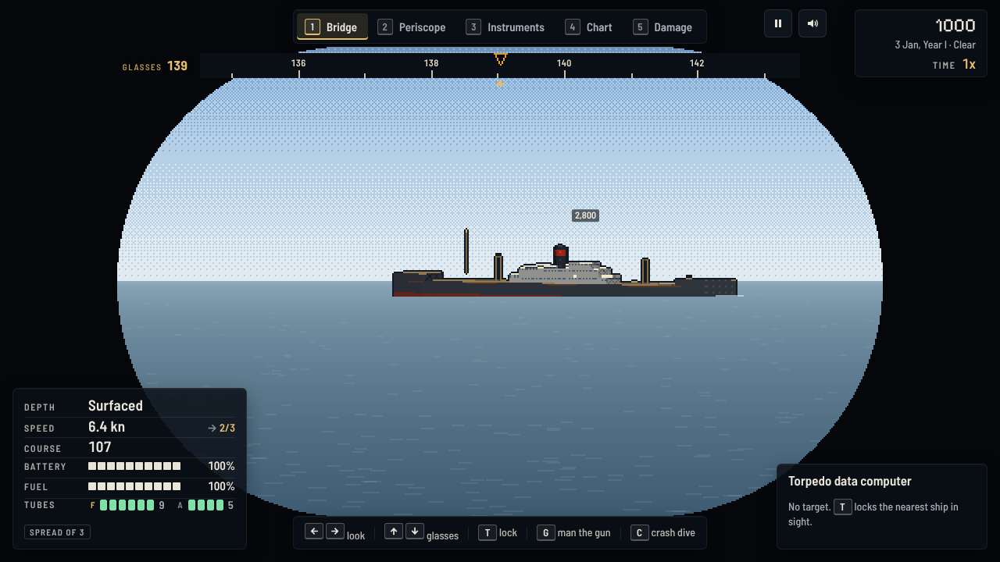
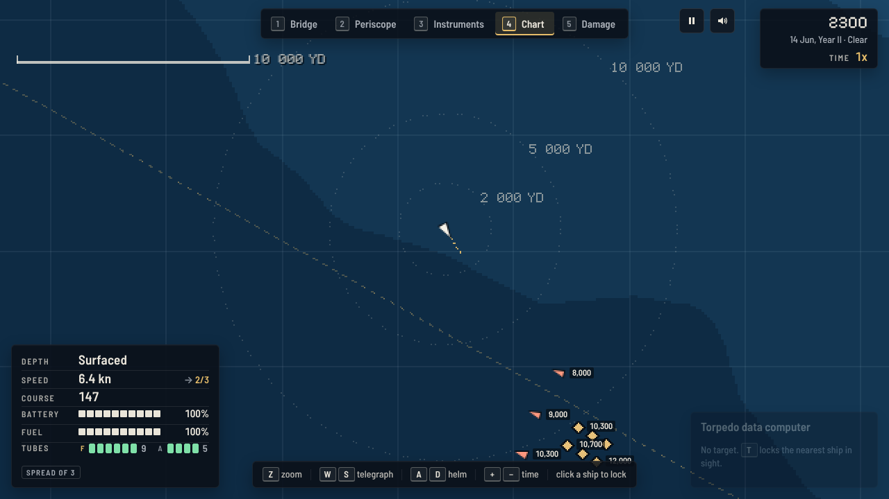
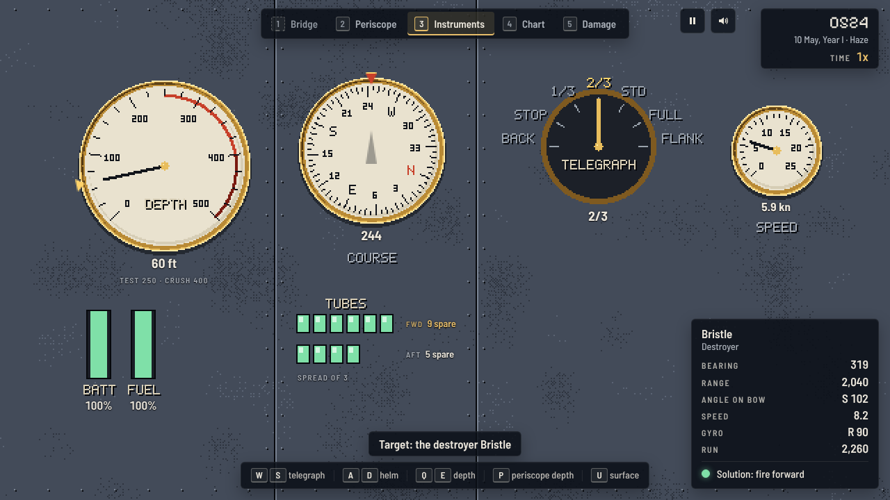

# Puma Service

**Wolf convoys, one fleet boat, five years of war.** A remake of *Silent Service* (MicroProse, 1985, Commodore 64): a puma commands a fleet submarine against the Wolf Empire's convoys, from the periscope, the bridge and the chart, in modern hi-bit pixel art.

## Play

[greykit.com/games/pumaservice](https://greykit.com/games/pumaservice/)

No install required. Plain scripts, no build step, nothing fetched at play time: every picture is drawn and every sound synthesised in the page; the two typefaces ship with it.


## How it plays

The Empire's convoys carry its oil, its ore and its troops along sea lanes between its islands. Find them, get ahead of them, and sink the merchants without being sunk by their escorts.


- **The periscope** shows what is really there: every ship is traced from a 3D model at the angle on the bow it truly shows, cut off by the horizon when it is far away (masts first, then the hull). Raise it, train it, lock a target.
- **The torpedo data computer** keeps an estimate of the target's position, course and speed and solves the shot, allowing for the torpedo's turn out of the tube. In Classic you judge the angle on the bow and the speed yourself.
- **The escorts** hear you when you are fast, see you when you show, and ping you when they hunt. A contact sends them in to lay a pattern of depth charges. Go deep, slow and quiet, and they give up in time.
- **The boat** runs on diesels on the surface and on the battery below. Below the test depth the hull groans; below the crush depth it fails, and damage brings that depth up. The damage report shows her cut away: where she is hurt, the water in her, her depth against her crush depth, and what the crew are mending.




There are three ways to play: **target practice** (torpedoes, or the deck gun), eight **convoy actions** (single engagements from the first month of the war to the last) plus a custom one, and **war patrols**: a career across five years of the Wolf War, out of Port Talon and later the forward bases, with patrol zones, aircraft, weather, refits, medals, promotions, and newer boats and better torpedoes as the war goes on.



## Reality, and Classic and Field

**Reality** is the war itself, set before a game: limited visibility, convoy zig-zags, expert escorts, angle on bow by eye, torpedo failures (the early war's duds, prematures and deep runners), and port-only repairs. Each one switched on adds to the reality percentage that tonnage counts for.

**Aids** never change the war. **Classic** plays as 1985 did: the instruments and your eyes. **Field**, the default, adds a solution line, torpedo tracks, range labels, automatic ranging, slowing time for news, the escorts' hearing on the chart and key hints. Settings has each on its own; `L` switches the set at sea.



## Keys

| | |
|---|---|
| `W` `S` | telegraph |
| `A` `D` | helm (hold to swing the ordered course) |
| `Q` `E` / `PgUp` `PgDn` | depth; `P` periscope depth, `U` surface, `C` crash dive |
| `1`–`5` / `Tab` | bridge, periscope, instruments, chart, damage; `Shift` `Tab` the one before |
| Arrows | the station in front of you: train and raise the periscope, look round from the bridge (lay the gun when it is manned), the helm and the telegraph on the instruments, the chart and the damage report |
| `T` | lock the ship nearest the crosshair; `R` stadimeter range |
| `[` `]`, `,` `.` | angle on bow and target speed on the TDC |
| `Space` | fire, a torpedo a press; `F` forward or after tubes, `V` a spread that fans the next shots |
| `G` | man the deck gun |
| `X` / `Y` | silent running / radar |
| `+` `−` / `Backspace` | time compression / back to 1x |
| `O` | tie up at a base |
| `Esc` / `L` / `M` / `?` | pause / Classic or Field / sound / every key |
| `Shift` | held: finer dials, a faster helm and periscope |

A gamepad works too, menus and all: the sticks steer and train, `A` fires, `X` locks, the bumpers change station, the triggers time, and `Back` held is a second layer for the rest. Help has the whole map, and the key hints show the pad's buttons once you touch it. On a keyboard laid out other than US, the hints show the letter on your own key where the browser can tell.

## Code

```
js/engine/   the war, DOM-free: the sea, the boat, the ships and convoys, seeing and being seen, the escorts and aircraft,
             torpedoes and the TDC, the scenarios and the career, a step of it all, and a bot
js/art/      the pixel art: the kit, the tracer, the ship models, the view out, the chart, the instruments, the damage report
js/          rendering, the HUD, input, sound, the screens, settings and the service record, and the loop
tools/       sim-check (the bot plays every convoy action headless), asset stamps and checks, icons, the share card, the ship sheet
```

`node tools/sim-check.js` plays the game headless: the sea is sound, the firing solution hits a target on a steady course, the bot sinks ships in the convoy actions, the escorts hunt, and a game replays step for step and survives being saved and loaded half way. `--patrol` also sails a whole war patrol. `node tools/stamp-assets.js` stamps every script and stylesheet with its hash after an edit. `tools/preview.html` is the ship sheet; `tools/og.html` draws the share card; `node tools/make-icons.js` the icons.

## Credits

The original *Silent Service* was designed by Sid Meier for MicroProse, 1985. This remake is not affiliated with MicroProse; no code, art or audio from it is used. The boats, the ships, the islands and the war are our own.

Built by [greykit.com](https://greykit.com/). MIT licence.
