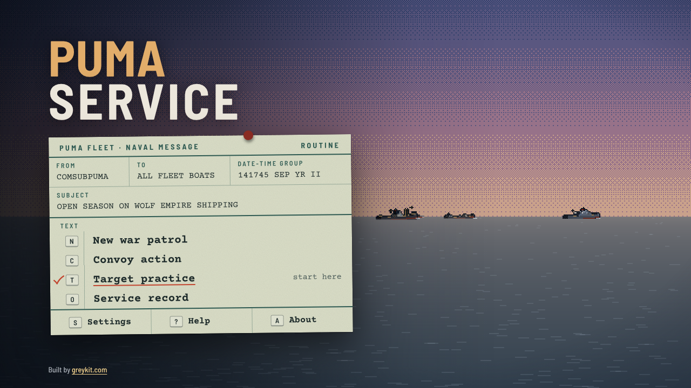
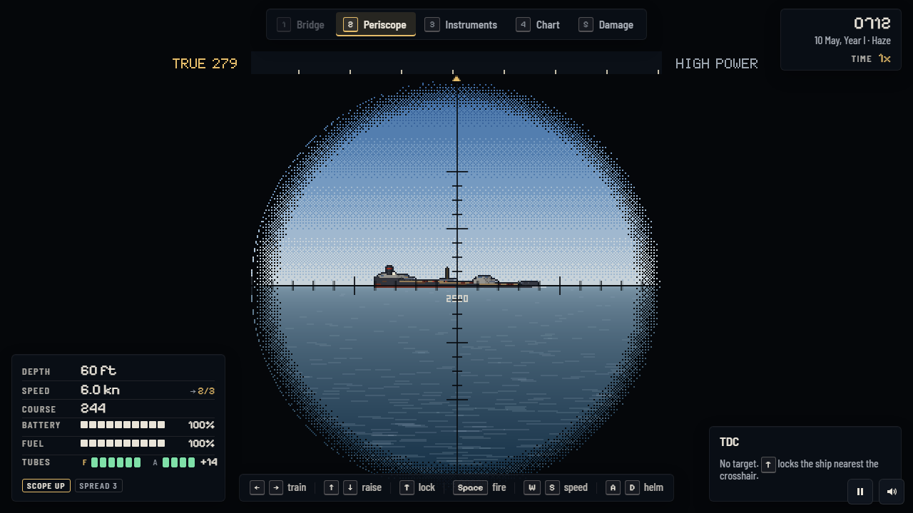
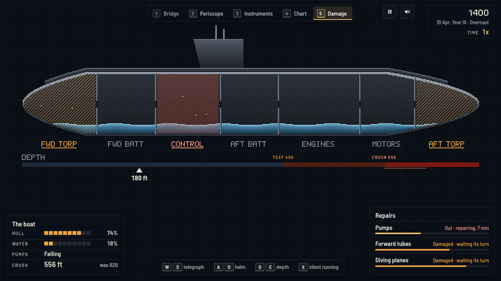

# Puma Service

**Wolf convoys, one fleet boat, five years of war.** A remake of *Silent Service* (MicroProse, 1985, Commodore 64): a puma commands a fleet submarine against the Wolf Empire's convoys, from the periscope, the bridge and the chart, in modern hi-bit pixel art.

**Play:** [greykit.com/games/pumaservice](https://greykit.com/games/pumaservice/)

## How it plays

The Empire's convoys carry its oil, ore and troops between its islands. Find them, get ahead of them, and sink the merchants without being sunk by their escorts. Raise the periscope, lock a target, and the torpedo data computer solves the shot. The escorts hear you when you are fast, see you when you show, and lay depth charges on a contact; go deep, slow and quiet and they give up in time. Below the test depth the hull groans, below the crush depth it fails, and damage brings that depth up.

There are three ways to play: **target practice**, eight **convoy actions** plus a custom one, and **war patrols**, a career across five years of the Wolf War with patrol zones, aircraft, weather, refits, medals, promotions and newer boats as the war goes on.

**Reality** settings, chosen before a game, make the war harder (limited visibility, zig-zags, expert escorts, torpedo failures, port-only repairs) and raise the percentage tonnage counts for. **Classic** plays as 1985 did: the instruments and your eyes. **Field**, the default, adds a solution line, torpedo tracks, range labels, automatic ranging, key hints and other aids, each of which can be switched on or off.

## Keys

| | |
|---|---|
| `W` `S` / `A` `D` | telegraph / helm |
| `Q` `E` | depth; `P` periscope depth, `U` surface, `C` crash dive |
| `1`–`5` / `Tab` | bridge, periscope, instruments, chart, damage |
| `T` | lock the ship nearest the crosshair |
| `Space` | fire a torpedo |
| `Esc` / `L` / `M` / `?` | pause / Classic or Field / sound / every key |

A gamepad works too, menus and all; Help has the whole map.

## Saves

Kept in the browser's `localStorage` under keys starting `pumaservice_`. **Settings → Forget everything** clears them.

## Credits

The original *Silent Service* was designed by Sid Meier for MicroProse, 1985. Puma Service is not affiliated with MicroProse and uses none of the original's code, art, sound or text. The boats, the ships, the islands and the war are new.

Typefaces: [Barlow Semi Condensed](https://fonts.google.com/specimen/Barlow+Semi+Condensed), [Courier Prime](https://fonts.google.com/specimen/Courier+Prime) and [Pixelify Sans](https://fonts.google.com/specimen/Pixelify+Sans), under the SIL Open Font License.

Working on the game: [DEVELOPMENT.md](DEVELOPMENT.md).

By Matthew "Shan" Romanek, with Claude. Built by [greykit.com](https://greykit.com/).

Made for my own play. Nothing here is offered: no support, no updates, no licence.
